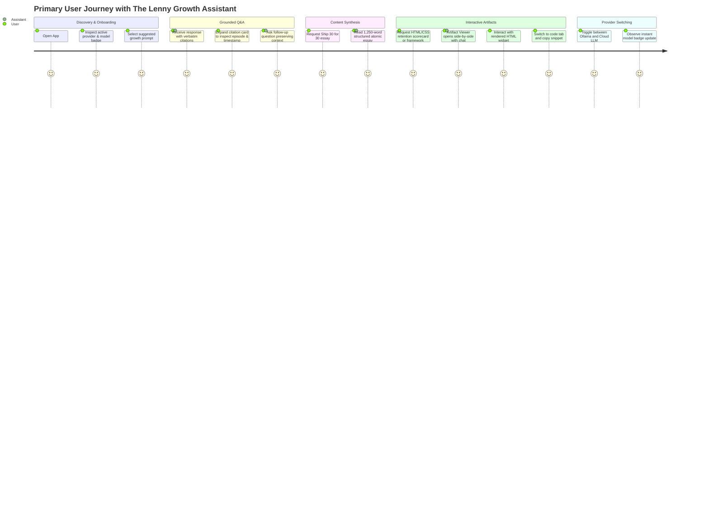

# Product Requirements Document (PRD)

## Product Name: The Lenny Growth Assistant
**Author:** Forward Deployed Engineering Team  
**Target Audience:** Product Managers, Growth Leads, Founders, Executive Evaluators  
**Date:** October 2026  
**Status:** Approved for Implementation  

---

## 1. Product Overview & Discovery Brief

### 1.1 Executive Summary
*The Lenny Growth Assistant* is an enterprise-grade, local-first conversational AI web application built to convert the collective wisdom of *Lenny's Podcast* and *Lenny's Newsletter* into an actionable, interactive copilot. Product teams, growth leads, and founders frequently face critical strategic questions—from defining Product-Market Fit (PMF) and instrumenting retention curves to optimizing onboarding funnels and selecting pricing models. While Lenny Rachitsky’s interviews with over 200+ world-class operators (e.g., Shreyas Doshi, Elena Verna, Brian Balfour, Rahul Vohra, Casey Winters) contain the answers, finding, synthesizing, and applying those insights is time-consuming and fragmented.

The Lenny Growth Assistant solves this by providing:
1. **Grounded Answers with Strict Citations:** Real-time retrieval across verified podcast transcripts, citing exact episodes, guests, timestamps, and quotes.
2. **Multi-Turn Isolated Sessions:** Persistent conversations with contextual memory that never leak data across sessions.
3. **Dedicated Content Skills:** One-click transformation of complex advice into an ~1,250-word **Ship 30 for 30–style atomic essay**.
4. **Interactive In-App Artifacts:** Generation of rich Markdown frameworks and sandboxed HTML/CSS calculators, dashboards, and checklists rendered side-by-side in an in-app **Artifact Viewer**.
5. **Flexible Local-to-Cloud Runtime:** Full local offline execution via **Ollama** alongside instant toggling to **Anthropic Claude** or **OpenAI**.

---

## 2. User & Problem Definition

### 2.1 Primary Personas
- **The Senior Product Manager / Growth Lead:** Needs battle-tested frameworks to solve specific funnel bottlenecks (e.g., "How does Elena Verna recommend structuring product-led growth experiments?"). Wants actionable takeaways, not generic AI platitudes.
- **The Early-Stage Founder:** Needs rapid strategic guidance on PMF benchmarks (e.g., Rahul Vohra's 40% 'Very Disappointed' rule) and pricing strategies without spending hours searching transcripts.
- **The Content / Product Marketing Operator:** Needs to convert interview insights into publishing-ready thought leadership essays and internal strategy memos quickly.
- **The Technical Evaluator / Reviewer:** Needs to verify the architecture, test the system locally with Ollama, inspect citations, and validate security controls without dealing with brittle setup scripts.

### 2.2 Jobs-to-be-Done (JTBD)
- **When** I am designing a growth experiment or diagnosing retention,  
  **I want to** query Lenny’s transcript corpus for proven operator methodologies,  
  **So that I can** adopt industry best practices without wading through hours of audio recordings.
- **When** I synthesize strategic insights for my executive team,  
  **I want to** transform conversational answers into structured Ship 30 essays or visual HTML frameworks,  
  **So that I can** immediately share polished, persuasive artifacts.
- **When** I work with proprietary product data,  
  **I want to** run the assistant completely offline using a local LLM via Ollama,  
  **So that I can** ensure zero data leakage and eliminate API costs.

### 2.3 Pain Points Removed
| Current State (Pain Point) | Assistant State (Relief) |
| :--- | :--- |
| Generic LLMs hallucinate plausible-sounding but fabricated product metrics and attribution. | Strict RAG pipeline forces answers to be grounded exclusively in Lenny's transcripts with source episode citations; acknowledges when knowledge is missing. |
| Operators manually scrub 2-hour podcasts or search 50-page transcript PDFs. | Sub-second hybrid retrieval surfaces the exact 3–5 most relevant transcript chunks with guest names and timestamps. |
| Transforming chat answers into structured memos requires tedious copy-pasting and reformatting. | Built-in Ship 30 for 30 skill automatically formats 1,250-word atomic essays with compelling hooks, skimmable headings, and clear takeaways. |
| Generated code or UI mockups must be exported to CodePen or external HTML viewers. | Integrated, sandboxed Artifact Viewer renders Markdown and live HTML/CSS widgets side-by-side with conversation. |
| Enterprise teams struggle with cloud LLM vendor lock-in and privacy constraints. | Dynamic provider abstraction enables instant switching between local Ollama and Cloud LLMs (Anthropic Claude / OpenAI) with UI transparency. |

---

## 3. Measurable Success Metrics

| Metric | Target | Rationale & Measurement Method |
| :--- | :--- | :--- |
| **Grounded Source Citation Rate** | **≥ 98%** | Percentage of informational responses that include verified episode, guest, and chunk citations. Monitored via API response metadata. |
| **Hallucination & Fabrication Rate** | **0%** | Zero fabricated quotes or invented episode references. Strict refusal prompt triggers when retrieval similarity is below threshold. |
| **Out-of-Domain Refusal Precision** | **100%** | When asked non-Lenny or irrelevant topics (e.g., general quantum physics), the assistant explicitly acknowledges absence of transcript evidence. |
| **Ship 30 Essay Structural Compliance** | **≥ 95%** | Generated essays adhere to target length (~1,000–1,300 words), hook structure, bold emphasis, and actionable takeaway guidelines. |
| **Artifact Rendering Security Rate** | **100%** | Zero script escapes, parent window access, or storage leaks from untrusted HTML artifacts (verified by automated security tests). |
| **Evaluator Setup Success** | **< 3 minutes** | Time from `git clone` to operational local chat using Docker Compose or single-command local runner. |
| **Session Isolation Integrity** | **100%** | Zero cross-session context contamination across concurrent or sequential chats. |

---

## 4. Scope & Boundary Decisions

### 4.1 Included Scope
- **Complete Full-Stack Application:** FastAPI backend, PostgreSQL relational database, and modern web interface.
- **Hybrid RAG Pipeline:** Ingestion, cleaning, chunking (500–800 tokens with overlap), metadata tagging (guest, title, URL, timestamp), indexing, and semantic retrieval.
- **Modular Agent & Routing:** Dynamic intent classification routing between standard Q&A, follow-up clarification, Ship 30 essay generation, and artifact creation.
- **Ship 30 for 30 Skill:** Dedicated algorithmic skill encoding Nicolas Cole & Dickie Bush principles (Atomic Essay framework, hook, rhythm, takeaways).
- **Claude-Style Artifact Viewer:** Side-by-side workspace with tabbed navigation: Interactive Preview, Syntax-Highlighted Code, and Copy to Clipboard.
- **Iframe Security Sandbox:** Rigorous sandbox configuration preventing XSS, cookie harvesting, or parent DOM manipulation from generated HTML.
- **Dual LLM Provider Abstraction:** Seamless toggle between Local Ollama (`llama3.2:3b`, `mistral`, `llama3`) and Cloud LLM (`claude-3-5-sonnet`, `gpt-4o`).
- **Resilience Layer:** Fallbacks for offline Ollama, missing API keys, database connection drops, and empty search results.
- **Developer Documentation & Tests:** Automated test suite (API, persistence, retrieval, agent routing, security), PRD, architecture, design doc, and runbook.

### 4.2 Excluded Scope (Non-Goals) & Justification
1. **Audio Streaming & Playback:** Real-time audio waveform scrubbing of the raw podcast MP3 files is excluded.  
   *Justification:* The primary client requirement is grounded text retrieval and content synthesis; streaming gigabytes of audio introduces unnecessary operational overhead.
2. **Paywalled Substack Comment Scraping:** Live scraping of subscriber comments is excluded.  
   *Justification:* Violates terms of service and compromises reproducibility for fresh evaluators. Transcripts are self-contained.
3. **Multi-Tenant Enterprise RBAC & Billing:** Organization hierarchy, Stripe billing, and granular user roles are excluded.  
   *Justification:* The assignment evaluates Forward Deployed AI system capabilities, not SaaS monetization infrastructure.
4. **Fine-Tuning Local Models:** We do not fine-tune custom weights for Ollama.  
   *Justification:* RAG provides verifiable citations and dynamic knowledge updates; fine-tuning black-boxes facts and causes hallucinated attributions.

---

## 5. Assumptions

1. **Host Hardware for Ollama:** Evaluators running local Ollama may test on standard developer laptops (16GB RAM, standard CPU/GPU). Therefore, the default local model configuration defaults to lightweight, high-performance models (`llama3.2:3b` or `mistral:7b`), with graceful fallback notifications if Ollama is not running.
2. **Knowledge Base Availability:** An evaluator may not have high-speed internet to download 500MB of transcripts during grading. We bundle a curated, high-density sample of transcripts covering core growth topics (PMF, Onboarding, Retention, Pricing, Experimentation) in `data/fixtures/`, while providing an ingestion script for ingesting full repositories.
3. **Database Portability:** While PostgreSQL with async SQLAlchemy is the primary persistence engine defined in `docker-compose.yml`, an automatic SQLite fallback is enabled for single-command developer test runs if PostgreSQL is not active on the evaluator's workstation.
4. **Agent SDK Architecture:** We implement the Anthropic Agent / Pi Coding Agent pattern with explicit skill registries, structured tool declarations, and intent routing, ensuring clean separation of concerns.

---

## 6. End-to-End User Flows

---

## 7. Risks & Mitigation Matrix

| Risk | Impact | Probability | Mitigation Strategy |
| :--- | :--- | :--- | :--- |
| **Hallucination / Fake Quotes** | High | Medium | Strict system instructions requiring verbatim or cited claims; similarity threshold below which assistant explicitly states lack of transcript evidence. |
| **Ollama Service Unavailable** | High | Medium | Operational health check tests Ollama port; backend detects connection failure and displays actionable UI toast instructing user to run `ollama serve`. |
| **Cloud API Rate Limits / Key Missing** | Medium | Medium | Provider abstraction validates API key presence at startup; offers graceful fallback with clear diagnostic messaging. |
| **Cross-Session Data Leakage** | High | Low | Database queries strictly scoped by `session_id`; agent context reloaded exclusively from active session history. |
| **Malicious / Unsafe HTML Artifacts** | High | Low | Untrusted HTML rendered inside an isolated `<iframe>` with restrictive `sandbox` attributes, blocking parent DOM access, cookies, and top-level navigation. |
| **Context Window Overflow** | Medium | Medium | Transcript chunk retrieval limited to top $k=4$ chunks; chat history sliding window summarizes older turns if context exceeds model limits. |

---

## 8. Acceptance Criteria

1. **Grounded Answers:** Answers accurately reflect Lenny transcript contents and cite episode titles and guest names.
2. **Out-of-Scope Handling:** Prompts unrelated to transcripts trigger a polite refusal stating the topic is outside the available knowledge base.
3. **Session Persistence:** Reloading the browser or switching between sessions in the sidebar preserves full conversation history.
4. **Ship 30 Skill:** Generates an essay of approximately 1,250 words with a clear hook, narrative progression, and actionable takeaways.
5. **Artifact Viewer:** Renders Markdown and HTML/CSS side-by-side with the chat; includes Preview, Code, and Copy actions.
6. **Provider Toggle:** User can switch between Ollama and Cloud LLM via configuration/UI, and active model is visible.
7. **One-Command Setup:** Application starts reliably using Docker Compose or standard local commands without manual patching.
