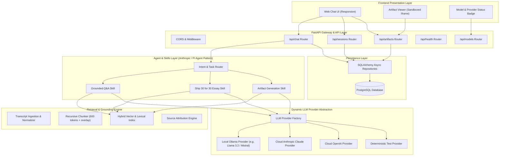
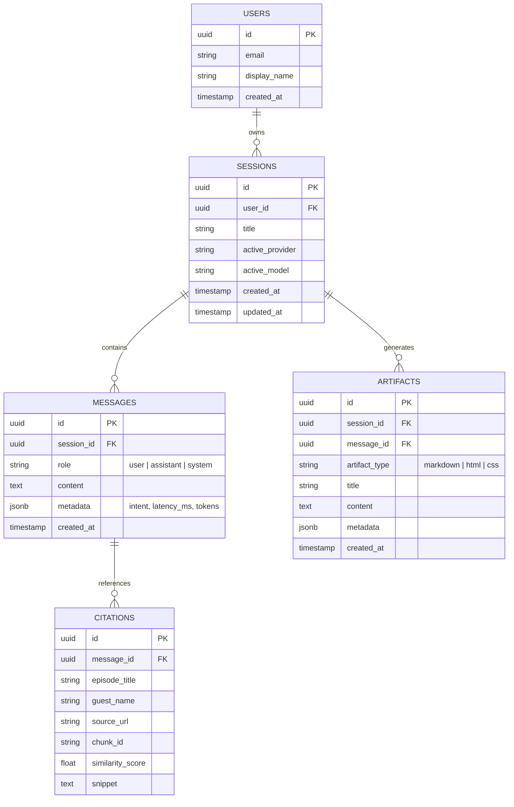
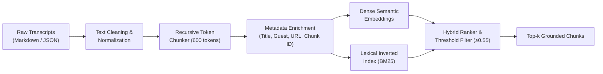
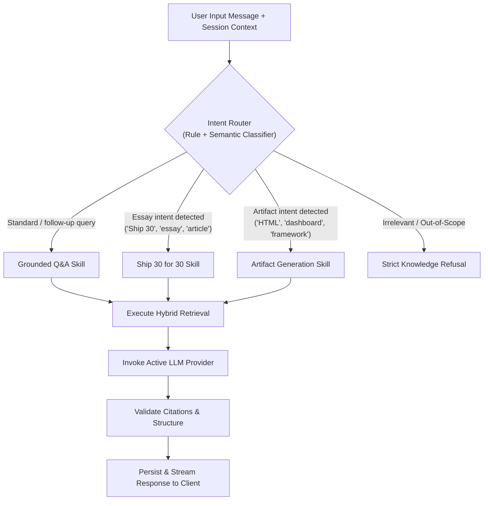
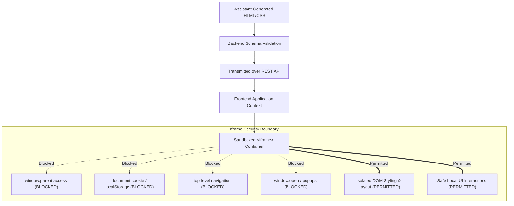

# System Architecture Specification

## Product: The Lenny Growth Assistant
**Document:** Technical Architecture & Design Specification  
**Version:** 1.0.0  
**Author:** Forward Deployed Engineering Team  
**Status:** Approved for Implementation  

---

## 1. System Overview

The Lenny Growth Assistant is designed as a modular, local-first, full-stack AI platform. The system operates under a clear separation of concerns across presentation, orchestration, retrieval, persistence, and inference layers.



---

## 2. Frontend Architecture

The user interface is engineered as an interactive Single-Page Application (SPA) with real-time feedback, accessibility, and side-by-side artifact rendering.

### Key Components:
1. **Chat Sidebar (`Sidebar`):**
   - New Chat action with keyboard shortcut (`Cmd/Ctrl + K`).
   - Session history list with active indicator and delete capability.
   - Provider & model indicator (displays active provider: Local Ollama vs. Cloud Claude/OpenAI).
   - Knowledge base stats (indexed transcripts and chunks count).
2. **Conversation Stream (`ChatArea`):**
   - Header with active session title and model indicator.
   - Message list rendering User bubbles and Assistant markdown responses with syntax highlighting.
   - Grounded Source Cards: Expandable cards below assistant responses detailing Episode Title, Guest Name, Transcript Chunk, and Relevance Score.
   - Suggested Follow-up chips for guided exploration.
   - Interactive Prompt Input with multiline expansion and submit button.
3. **Claude-Style Artifact Viewer (`ArtifactViewer`):**
   - Positioned side-by-side on desktop viewports (collapsible to bottom/modal on mobile).
   - Tabbed workspace:
     - **Preview Tab:** Renders Markdown directly or sandboxed HTML/CSS widgets inside a strictly isolated `<iframe>`.
     - **Code Tab:** Shows raw syntax-highlighted code.
     - **Copy Button:** One-click clipboard copy.
     - **Close Button:** Dismisses viewer to maximize chat width.

---

## 3. FastAPI Backend Architecture

The backend is built with **FastAPI** leveraging asynchronous I/O, Pydantic v2 validation, and clean dependency injection.

### Package Structure:
```
backend/app/
├── api/
│   ├── routes_sessions.py   # Session lifecycle and message history
│   ├── routes_chat.py       # Core conversational agent interaction
│   ├── routes_artifacts.py  # Artifact retrieval and compilation
│   ├── routes_health.py     # Diagnostic health and readiness probes
│   └── routes_models.py     # Model provider inspection and switching
├── core/
│   ├── config.py            # Pydantic BaseSettings (.env loader)
│   ├── logging.py           # Structured JSON logger
│   └── security.py          # CORS and input sanitization helpers
├── db/
│   ├── session.py           # Async SQLAlchemy engine & session maker
│   ├── base.py              # Declarative Base
│   └── migrations/          # Alembic / SQL migration scripts
├── models/
│   ├── session.py           # Session ORM model
│   ├── message.py           # Message ORM model
│   └── artifact.py          # Artifact ORM model
├── schemas/
│   ├── chat.py              # Request/Response schemas for chat
│   ├── session.py           # Session schemas
│   ├── artifact.py          # Artifact schemas
│   └── health.py            # Health probe schemas
├── agents/
│   ├── router.py            # Intent & task routing classifier
│   ├── orchestrator.py      # Core agent loop coordinating skills
│   └── state.py             # Agent conversation state
├── skills/
│   ├── qa_skill.py          # Grounded question-answering skill
│   ├── ship30_skill.py      # Ship 30 for 30 essay generation skill
│   └── artifact_skill.py    # Markdown & HTML/CSS artifact skill
├── retrieval/
│   ├── chunker.py           # Text splitter with metadata preservation
│   ├── index.py             # Hybrid vector & BM25 retrieval index
│   └── sources.py           # Citation and source trace generator
└── services/
    ├── provider_factory.py  # LLM Provider factory
    ├── ollama_provider.py   # Local Ollama client implementation
    ├── anthropic_provider.py# Anthropic Claude client implementation
    ├── openai_provider.py   # OpenAI client implementation
    └── mock_provider.py     # Deterministic mock provider for tests
```

---

## 4. Database Schema & Persistence

PostgreSQL is the system of record. All database operations use async SQLAlchemy with foreign key constraints, indexing on lookup columns, and cascade deletes.

### Entity Relationship Diagram (ERD):


---

## 5. REST API Specifications

| Method | Endpoint | Description | Request Body | Response |
| :--- | :--- | :--- | :--- | :--- |
| `GET` | `/api/health` | Diagnostic probe for DB, Ollama, Cloud LLM, & Index | None | `HealthResponse` |
| `GET` | `/api/models` | List available providers and current active model | None | `ModelsListResponse` |
| `POST` | `/api/models/toggle` | Switch active provider (e.g. `ollama` ↔ `anthropic`) | `ProviderToggleRequest` | `ProviderToggleResponse` |
| `GET` | `/api/sessions` | List all conversation sessions ordered by `updated_at` | None | `List[SessionSummary]` |
| `POST` | `/api/sessions` | Create a new conversation session | `CreateSessionRequest` | `SessionDetail` |
| `GET` | `/api/sessions/{id}` | Get session details and message history | None | `SessionDetail` |
| `DELETE`| `/api/sessions/{id}` | Delete a session and its cascade records | None | `DeleteStatus` |
| `POST` | `/api/chat` | Send query, execute agent routing, return response | `ChatRequest` | `ChatResponse` |
| `GET` | `/api/artifacts/{id}` | Retrieve artifact code and metadata | None | `ArtifactResponse` |

---

## 6. Knowledge Ingestion & Hybrid RAG Pipeline



### Ingestion Details:
1. **Cleaning:** Removes transcript disclaimers, sponsor ads, filler timestamps, and normalizes unicode characters.
2. **Chunking Strategy:** Chunks are created at natural paragraph boundaries (approx. 500–700 words / 600 tokens) with a 100-token sliding overlap to avoid splitting insights mid-sentence.
3. **Metadata Schema:** Every chunk preserves:
   - `episode_title`: Title of the podcast episode.
   - `guest_name`: Name of the interview guest (e.g., *Elena Verna*, *Rahul Vohra*).
   - `source_url`: Link to the transcript or Substack post.
   - `chunk_id`: Unique identifier (`ep_42_chunk_07`).
   - `chunk_index`: Position within the episode.
4. **Grounding Verification:** A dynamic cosine/lexical threshold filter ($0.55$) is applied. If all chunks fall below the relevance threshold, the system flags the query as **unsupported** and returns a strict refusal rather than hallucinating.

---

## 7. Agent Architecture & Intent Routing

The agent layer follows the **Anthropic Claude Agent / Pi Coding Agent** architecture, utilizing specialized skills rather than an oversized monolithic prompt:



---

## 8. LLM Provider Abstraction

A unified abstract base class (`BaseLLMProvider`) defines the contract for all inference providers:

```python
class BaseLLMProvider(ABC):
    @abstractmethod
    async def generate(self, messages: list[ChatMessage], system_prompt: str, temperature: float = 0.2) -> LLMResponse:
        pass

    @abstractmethod
    async def health_check(self) -> ProviderHealth:
        pass
```

### Implementations:
1. **`OllamaProvider`:** Communicates with the local Ollama daemon via its REST API (`http://localhost:11434/api/generate` or `/api/chat`). Features automatic connection retry, model check, and timeout handling.
2. **`AnthropicProvider`:** Connects to the Anthropic Messages API using `claude-3-5-sonnet` with streaming support.
3. **`OpenAIProvider`:** Connects to OpenAI API (`gpt-4o` / `gpt-4o-mini`).
4. **`MockLLMProvider`:** Deterministic provider for unit and CI testing with guaranteed grounded outputs and zero network latency.

---

## 9. Artifact Viewer & Security Architecture

### Untrusted HTML Security Model:
User or assistant generated HTML/CSS artifacts are treated as **untrusted third-party content**.



### Security Policy:
- **Sandbox Attributes:** `sandbox="allow-scripts"` (strictly **omits** `allow-same-origin`, `allow-top-navigation`, and `allow-popups`).
- **Origin Isolation:** Rendered with `srcdoc` or `blob:` URL with unique origin `null`, preventing script execution from accessing the application's auth tokens or cookies.
- **Content Security Policy (CSP):** Prohibits external network fetches (`connect-src 'none'`) inside the iframe artifact.

---

## 10. Observability & Logging

- **Structured JSON Logging:** All log entries emitted with ISO-8601 timestamps, log level, request ID, session ID, and duration.
- **Zero Credential Exposure:** Environment variables, API keys, and authorization headers are scrubbed before logging.
- **Diagnostic Metrics:** Latency per component (retrieval time, model response time, persistence time) captured in response metadata.

---

## 11. Deployment Topology

The application is bundled for immediate deployment via **Docker Compose**:
- **Service 1 (`db`):** `postgres:16-alpine` on port `5432` with health checks.
- **Service 2 (`backend`):** FastAPI application on port `8000` with hot reload in development.
- **Local Host:** Ollama running natively on `localhost:11434`, bridged to Docker via `host.docker.internal`.
