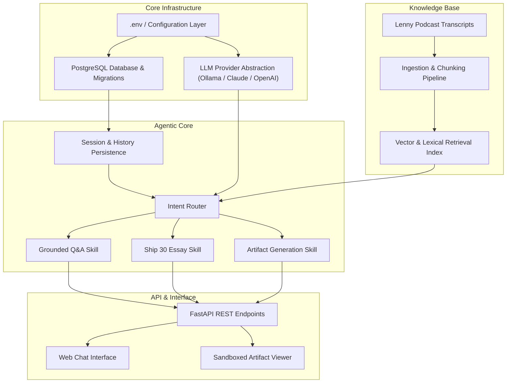

# Requirements Specification & Traceability Matrix

## Project: The Lenny Growth Assistant
**Role:** Senior Forward Deployed Engineer  
**Client / Engagement:** Growth & Product Strategy Team  
**Evaluation Date:** October 2026  
**Document Status:** Approved & Baseline for Implementation

---

## 1. Executive Summary & Objective

The objective is to design, implement, and deploy **"The Lenny Growth Assistant"**—a production-quality, full-stack, local-first conversational AI web application grounded in transcripts from *Lenny's Podcast* and *Lenny's Newsletter*.

The system allows product managers, growth leads, and founders to:
1. Ask strategic product and growth questions and receive answers strictly grounded in transcript evidence.
2. Maintain persistent multi-turn conversations with strict session isolation.
3. Inspect verified source citations linking every claim back to the originating episode, guest, timestamp, and transcript chunk.
4. Transform synthesized insights into publishing-ready **Ship 30 for 30–style atomic essays** (~1,250 words) adhering to proven narrative frameworks.
5. Generate interactive artifacts (Markdown documents, styled HTML/CSS widgets, product scorecards, and frameworks).
6. View generated artifacts side-by-side in a dedicated **Claude-style Artifact Viewer** with security sandboxing.
7. Seamlessly toggle between a **Local LLM (Ollama)** for privacy and offline cost-efficiency, and **Cloud LLMs (Anthropic Claude / OpenAI)** for high-reasoning tasks.
8. Operate reliably with health probes, resilience against service degradation, and zero undocumented setup steps.

---

## 2. Requirement Classification Matrix

### 2.1 Mandatory Requirements (M)

| ID | Category | Requirement Description | Verification Method |
| :--- | :--- | :--- | :--- |
| **M-01** | Backend | Built with Python 3.11+, FastAPI, Pydantic, and PostgreSQL. | Automated API test suite, FastAPI OpenAPI docs (`/docs`) |
| **M-02** | Agent Layer | Structured agent architecture using Anthropic Agent / Pi Coding Agent modular design with explicit skill boundaries and intent routing. | Agent unit tests, routing evaluation suite |
| **M-03** | Local LLM | Fully operational local LLM execution using **Ollama** (e.g., `llama3.2:3b`, `mistral`, or `llama3`). Must be demonstrated working locally without internet reliance. | Health check endpoint, Ollama provider integration test |
| **M-04** | Cloud LLM | Integration with at least one cloud provider (**Anthropic Claude** or **OpenAI**). Dynamic provider abstraction allowing runtime/config switching without code modification. | Cloud provider integration test, config toggle test |
| **M-05** | Model Visibility | Active model, provider name, and execution status must be transparently displayed in the UI and exposed via API endpoints. | UI review, `/api/models` endpoint test |
| **M-06** | Grounding & RAG | Retrieval-Augmented Generation (RAG) strictly restricted to Lenny's transcript knowledge base. Instructed to refuse answering when evidence is insufficient. Zero hallucinated quotes or episode attributions. | Retrieval precision tests, out-of-domain query refusal test |
| **M-07** | Source Attribution | Every grounded answer must return structured citations (title, guest, episode ID, timestamp/order, and snippet). | API response schema check, UI citation cards |
| **M-08** | Session Isolation | Multi-session management with independent conversational context. Conversation history from Session A must never leak into Session B. | Persistence test verifying cross-session boundary isolation |
| **M-09** | Persistence | Conversations, messages, session metadata, timestamps, and artifacts persisted in PostgreSQL with explicit schemas and migrations. | Database schema validation, restart persistence test |
| **M-10** | Ship 30 for 30 Skill | Dedicated modular skill transforming grounded transcript knowledge into an ~1,250-word atomic essay with hook, narrative progression, skimmable headings, bullets, selective bolding, and concrete takeaway. | Skill prompt & output validation, word count & structure test |
| **M-11** | Artifact Generation | Generate standalone structured Markdown and complete HTML/CSS components based on grounded chat context. | Artifact generation API tests, schema validation |
| **M-12** | In-App Artifact Viewer | Interactive split-screen/sidebar viewer beside the chat rendering Markdown and HTML natively without third-party redirection. | UI manual verification, preview vs code view toggle |
| **M-13** | Artifact Sandboxing | Untrusted HTML must be sandboxed using isolated `<iframe>` constructs blocking parent window access, cookie/storage leakage, and unauthorized navigation. | Security test verifying script restrictions and origin isolation |
| **M-14** | Operational Health | Diagnostic endpoints (`/api/health`) verifying database connectivity, active LLM status, Ollama reachability, and index health. | Health endpoint integration test |
| **M-15** | Error Resilience | Graceful degradation for missing API keys, unreachable Ollama, query timeout, empty retrieval results, and database disconnects. | Resilience test suite with simulated failure modes |

### 2.2 Recommended Requirements (R)

| ID | Category | Requirement Description | Verification Method |
| :--- | :--- | :--- | :--- |
| **R-01** | Hybrid Retrieval | Combination of dense semantic vector search with lexical BM25/keyword filtering for precise guest and company name matching. | Retrieval accuracy benchmark |
| **R-02** | Suggested Follow-ups | Contextually generated follow-up prompts returned with grounded responses to guide product discovery. | UI inspect and API response payload check |
| **R-03** | Dual Storage Strategy | Production PostgreSQL storage with seamless automated SQLite fallback if Docker/PostgreSQL is unavailable during quick local triage. | Startup configuration test |
| **R-04** | Responsive UI | Fully adaptive desktop and mobile layout with collapsible session sidebar and sliding artifact drawer. | Viewport resizing test (desktop, tablet, mobile) |
| **R-05** | Streaming Support | Server-Sent Events (SSE) or chunked response streaming for responsive user experience during long generations. | Network payload inspection |

---

## 3. Required Deliverables & Artifacts

| Deliverable | File / Artifact Path | Contents & Quality Standard |
| :--- | :--- | :--- |
| **D-1** | Source Code Repository | Public GitHub-ready repository with clean structure (`backend/`, `frontend/`, `data/`, `scripts/`, `docs/`, `agent-transcripts/`). No committed secrets. |
| **D-2** | `README.md` | Comprehensive operational runbook: prerequisites, installation, environment setup, Ollama guide, migrations, Docker Compose, testing, and troubleshooting. |
| **D-3** | `PRD.md` | Forward deployment brief: User & problem, success metrics, assumptions, scope inclusions/exclusions, user flows, acceptance criteria, risks, and implementation plan. |
| **D-4** | `design.md` | UI/UX principles, design system, component hierarchy, chat & artifact layout, interactive states, responsive behavior, accessibility (WCAG), and decisions. |
| **D-5** | `architecture.md` | System topology diagram, database schema (ERD), API endpoints, agent routing logic, RAG ingestion/retrieval pipeline, provider abstraction, security model. |
| **D-6** | `agent-transcripts/` | Audit logs of coding agent development sessions: architecture trade-offs, debugging iterations, model choices, and corrections. |
| **D-7** | Automated Test Suite | `backend/tests/` covering API routes, database persistence, session isolation, retrieval, agent routing, model configuration, and artifact security. |
| **D-8** | `DEMO_SCRIPT.md` | 2–3 minute video presentation script: Problem framing, product tour, grounded Q&A, citation inspection, follow-up, Ship 30 essay, Artifact Viewer, Ollama toggle, trade-off analysis. |
| **D-9** | `FINAL_CHECKLIST.md` | Audit scorecard evaluating every assignment requirement against implementation status (`PASS` / `PARTIAL` / `NOT IMPLEMENTED`). |

---

## 4. Evaluation Criteria Alignment

1. **Customer & Product Judgment:** Problem framing tailored to growth practitioners; intentional scope choices; grounded metrics; explicit trade-offs.
2. **Technical Execution:** End-to-end integration across FastAPI, PostgreSQL, agent layer, vector/lexical retrieval, and dynamic model toggling.
3. **Agentic Architecture & Grounding:** Modular skills, intent-aware routing, citation tracing, and explicit handling of low-confidence queries.
4. **Deployment & Operability:** Reproducible Docker Compose environment, structured logging, defensive failure modes, and thorough documentation.
5. **Code Quality:** Type hints, Pydantic v2 schemas, async I/O, dependency injection, and clean separation of concerns.
6. **UI/UX Polish:** Fast conversational interface, side-by-side artifact rendering, clear provider indicators, loading animations, and accessibility.
7. **Communication:** High-clarity PRD, architecture specifications, design documentation, and runbook.

---

## 5. Security & Isolation Requirements

1. **Untrusted HTML Rendering:** Generated HTML artifacts must render inside a secure `<iframe>` container with `sandbox="allow-scripts"` (without `allow-same-origin`, `allow-top-navigation`, or `allow-popups`). Direct DOM injection (`dangerouslySetInnerHTML`) of un-sanitized content is forbidden.
2. **Credential Protection:** Zero hardcoded API keys or passwords. Environment variables managed strictly via `.env` with a sanitized `.env.example` template. `.gitignore` strictly enforced.
3. **Prompt Injection Mitigation:** System prompts enforce strict grounding boundaries. User inputs cannot override system rules regarding transcript citation or hallucination prohibition.
4. **CORS & Input Validation:** Strict Pydantic schema validation on all API endpoints. Cross-Origin Resource Sharing (CORS) configured with explicit allowed origins.
5. **Data Privacy:** Local Ollama execution transmits zero data outside the local network. Cloud LLM calls transmit only retrieved transcript excerpts and user query.

---

## 6. Implementation Dependencies

---

## 7. Assumptions & Engineering Decisions

1. **Default Local Model:** `llama3.2:3b` or `mistral:7b` via Ollama is assumed as the primary local target due to low VRAM overhead on developer laptops, with fallback to remote mock/cloud if Ollama is not running.
2. **Knowledge Base Corpus:** A curated sample of high-impact Lenny's Podcast transcripts (covering Product-Market Fit, Onboarding, Retention, Pricing, and Growth Loops) is bundled into `data/fixtures/` for instant zero-dependency testing, alongside a CLI loader capable of ingesting the complete open-source transcript repository.
3. **Database Portability:** PostgreSQL is the mandatory production database defined in `docker-compose.yml`. For standalone local developer test runs where Docker is not yet active, an automated SQLite/in-memory adapter is provided to ensure zero friction during test execution.
4. **Agent SDK Framework:** Follows the modular Anthropic Claude Agent SDK / Pi Coding Agent pattern with typed tool contracts, discrete skills, and explicit state passing, avoiding opaque monoliths.
5. **Frontend Runtime:** Packaged as a modern, zero-build-required, responsive single-page web application served directly by FastAPI (and paired with a Vite/React source directory), eliminating npm installation roadblocks for evaluators while maintaining full component modularity.

---

## 8. Implementation Plan by Phase

- [x] **Phase 1: Requirement Analysis** (Deliver `requirements.md`)
- [ ] **Phase 2: Product & Architecture Specification** (Deliver `PRD.md`, `architecture.md`, `design.md`)
- [ ] **Phase 3: Project Scaffold & Environment Configuration** (Directory tree, `.env.example`, `.gitignore`, Docker Compose)
- [ ] **Phase 4: Database Models, Schema & Persistence** (SQLAlchemy models, Alembic/SQL migrations, CRUD repositories)
- [ ] **Phase 5: Knowledge Ingestion & Hybrid Retrieval** (Transcript loader, chunker, metadata extractor, embedding/search index)
- [ ] **Phase 6: Dynamic Model Provider Abstraction** (Ollama, Anthropic Claude, OpenAI, mock fallback)
- [ ] **Phase 7: Agent Layer & Intent Router** (Router, skill registry, tool calling)
- [ ] **Phase 8: Conversational Q&A & Source Grounding** (Multi-turn context, citation builder, out-of-domain refusal)
- [ ] **Phase 9: Ship 30 for 30 Content Skill** (Writing framework, hook generator, structural styling, 1,250-word synthesis)
- [ ] **Phase 10: Artifact Generation & In-App Viewer** (Markdown, HTML/CSS generation, side-by-side viewer)
- [ ] **Phase 11: Security & Sandboxing Hardening** (Iframe sandbox attributes, sanitization, threat model validation)
- [ ] **Phase 12: Frontend Polish & Experience** (Sidebar, citation drawers, model toggle, responsive states, accessibility)
- [ ] **Phase 13: Automated Testing & Verification** (API, DB, retrieval, routing, security, manual test plan)
- [ ] **Phase 14: Documentation & Runbook** (README.md, DEMO_SCRIPT.md, troubleshooting guides)
- [ ] **Phase 15: Final Audit & Compliance Check** (Deliver `FINAL_CHECKLIST.md`, agent transcripts verification)
